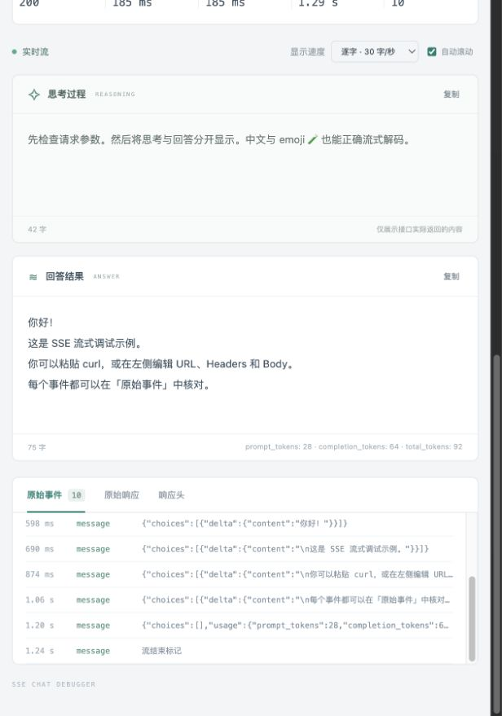

# SSE Chat Debugger

[简体中文](README.md) | [English](README.en.md)

A local tool for debugging SSE chat APIs. Edit a request or import a curl command, watch reasoning and answers appear character by character in separate panels, and inspect the raw SSE events.

Requires Node.js 20 or later. No third-party dependencies or `npm install` needed.

```bash
git clone https://github.com/ArkFishingLab/sse-chat-debugger.git
cd sse-chat-debugger
npm start
```

Open <http://127.0.0.1:8765>. Press Ctrl+C to stop the server. If the port is in use, run `PORT=8766 npm start` instead.

## Usage

The web interface currently uses Chinese labels. The corresponding labels are included below to help you find each control.

1. Click **Run demo (运行示例)** to try a simulated local SSE stream without an API key.
2. Click **Paste curl (粘贴 curl)** to import a Bash/macOS curl command, or edit the URL, method, headers, and body manually. Commands are parsed as text; no shell commands are executed.
3. Enable streaming in the body as required by your API, for example with `"stream": true`. The tool sends the body as entered and does not modify it automatically.
4. Click **Send request (发送请求)**. Reasoning and answers appear in separate panels. Choose a character-by-character playback speed or show incoming text immediately. Request timing is measured independently of the playback animation.
   - When a tool call arrives, the **Tool calls (工具调用)** section appears automatically. Arguments stream into separate panels for each call, with controls to copy individual arguments or all calls.
5. Expand individual events in **Raw events (原始事件)**, or inspect **Raw response (原始响应)** and **Response headers (响应头)**. You can stop the request, copy the output, or export a JSON debugging record.
6. Click **Save (保存)** to write complete request profiles to `data/requests.json` in the tool directory. URLs, headers, bodies, and parsing settings are preserved, including tokens, cookies, and non-JSON bodies. Requests and history are not saved automatically.

**Copy curl (复制 curl)** includes the currently enabled headers, body, and credentials so you can reproduce the request locally. Saved profiles are stored as plaintext without redaction. Changing ports or browsers, or restarting the server, retains access to the same profiles when using the same tool directory. The file is readable and writable only by the current user on supported platforms, and `data/` is excluded from Git. Copy `data/requests.json` to back up or move your profiles. The file is not served as a static web asset.

Legacy browser profiles are automatically imported when you visit their original browser and address. The browser copy is retained as a backup. Previously redacted fields cannot be recovered: fill them in and save again. Imports do not overwrite existing local profiles.

## Repeated runs, continuation, and JSON view

- **Repeated runs:** Set **Execution count (执行次数)** to 1–100, then send. Attempts run sequentially using independent copies of the same request captured when you click. API failures are retained and subsequent attempts continue. **Stop (停止)** aborts the current request and cancels queued attempts. The current stream is displayed while a batch runs. After completion or cancellation, choose a run to inspect its reasoning, answer, tools, raw response, events, and timing. The latest 100 runs remain in page memory only; refreshing clears them without changing saved request profiles.
- **Append result and run (追加结果并执行):** Select a completed run containing an answer, then click the separate button. Its answer is appended as an assistant message to that run's original `messages` or Responses `input`. String `input` is converted into a message array. The body editor is updated and one request is sent, preserving other parameters and headers. Saved profiles are unchanged. Reasoning and tool arguments are not appended; tools are never executed. Unsupported body structures show an error without sending a request.
- **JSON view (JSON 视图):** Switch between the raw body editor and a read-only JSON tree. Expand or collapse individual objects and arrays, or use the expand/collapse-all controls. Viewing JSON does not change the original request bytes. Invalid JSON remains editable in the raw view. Very deep or large trees can be inspected incrementally.

## Response parsing

- **Chat Completions:** `choices[0].delta.reasoning_content` / `reasoning` and `choices[0].delta.content`.
- **Chat Completions tool calls:** `choices[0].delta.tool_calls[]`. Function names and argument fragments are accumulated by `index`; missing or empty IDs do not interrupt a call, and parallel calls have separate panels. Supports `data:{...}` without a space and additional GLM `valid` fields. Intermediate arguments need not be valid JSON. Tools are displayed, never executed.
- **Responses:** `response.reasoning_text.delta`, `response.reasoning_summary_text.delta`, and `response.output_text.delta`.
- **Anthropic:** `delta.thinking` and `delta.text` in `content_block_delta` events.
- **Other APIs:** Enter JSON field paths in **Parsing / Settings (解析 / 设置)**, such as `data.reasoning`, `data.text`, or `choices[0].delta.content`. Entering either path switches to custom mapping mode.

These fields must contain **incremental text**, rather than complete snapshots. Full snapshots, nested JSON strings, custom tool events, and plain-text `data` values remain available in the raw events and may need additional protocol-specific support. Text and tool-call panels display choice 0; all candidates remain in the raw event inspector. Custom text field mappings do not disable standard Chat Completions tool-call parsing. The tool displays only reasoning or reasoning summaries actually returned by the API.

The SSE parser handles UTF-8, events split across network chunks, CR/LF/CRLF line endings, multiline `data`, event types, IDs, heartbeats, and `[DONE]`. A final event without a terminating blank line is marked as incomplete and is not dispatched as a complete SSE event. The first-event metric excludes heartbeats; the first-text metric measures the first recognized reasoning or answer text. These timings start when the local proxy sends the request, and total request duration excludes character playback. After `[DONE]`, the tool waits for the upstream connection to close so subsequent events can still be captured. You can click **Stop (停止)** at any time.

## Scope and data handling

- The server listens only on `127.0.0.1`. Requests are forwarded directly from your machine to the configured API, without an intermediary hosted platform. Internal APIs require the appropriate local network or VPN access.
- Supports HTTP/HTTPS requests with raw bodies. HTTPS certificates are validated. Multipart file uploads, custom certificate settings, system proxy integration, and the full curl option set are not supported.
- curl import supports `-X`, `-H`, `-d`, `--data-raw`, `--data-binary`, `--json`, `--url`, `-b`, `-u`, and common display options. Single and double quotes and common `$'…'` escapes are supported. Multiple data arguments, file references, and unsupported options produce explicit errors.
- Uses HTTP/1.1, recalculates Host and Content-Length, and removes connection-control headers. Supports gzip, deflate, and br response decompression. Redirects are not followed automatically: inspect Location and update the URL yourself. GET and HEAD requests cannot include a body.
- Request configurations are limited to 2 MB. The tool imposes no overall request timeout or proxy socket idle timeout; it keeps receiving until the API closes the connection or you stop the request. Stopping disconnects the upstream connection, while already received text finishes playing.
- Only the most recent 1,000 raw events and the first 2 MB of the raw response are retained. The raw-response limit is measured in JavaScript string length. Exported records include truncation flags. Parsed text continues to accumulate. Responses are rendered as plain text so HTML returned by an API is not executed.
- Exported records include assembled `toolCalls` with names, IDs, raw arguments, and finish reasons. They omit request headers and bodies and redact common credential-bearing response headers. Raw responses, tool arguments, and model output may contain business data; review them before sharing.

## Tests

```bash
npm ci
npm test
```

jsdom is a development-only dependency for DOM integration tests; running the tool itself still requires no dependency installation. Tests cover repeated runs and cancellation, run history selection, answer continuation, JSON trees, curl import/export round trips, SSE chunk boundaries, protocol mappings, fragmented tool arguments, parallel calls, full-fidelity file storage, access across ports, legacy imports, protection of damaged files, and real local HTTP proxy behavior, including compressed responses, waiting without a request deadline, cancellation, redirects, and errors.

Project files:

- `server.mjs`: Local proxy and demo endpoint.
- `profiles.mjs`: Local request profile storage.
- `core.mjs`: Protocol parsing.
- `app.mjs`: Browser interactions.
- `index.html` / `style.css`: Web interface.
- `test/`: Automated tests.

## Preview



## License

[MIT License](LICENSE)
