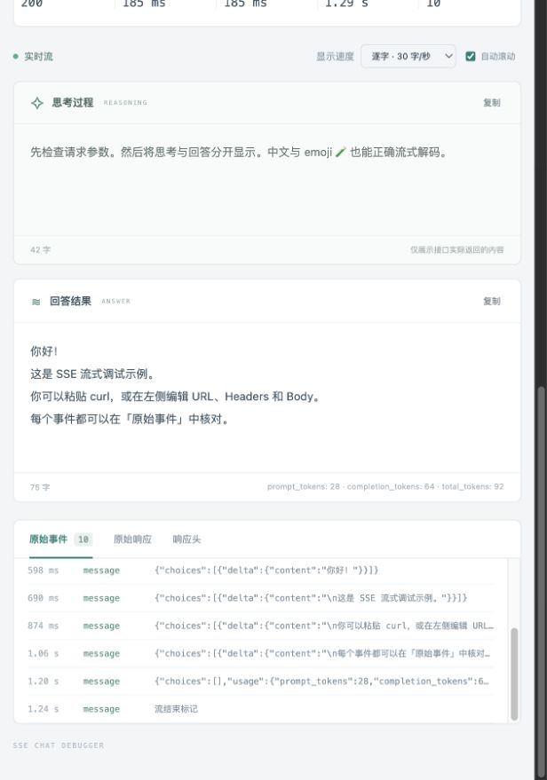

# SSE Chat 流式调试台

[简体中文](README.md) | [English](README.en.md)

独立的本地 SSE Chat 调试工具：编辑请求或导入 curl，将接口返回的思考与回答分别逐字展示，并核对原始 SSE 事件。

使用 Node.js 20 或更新版本，无第三方依赖，无需 npm install。

```bash
git clone https://github.com/ArkFishingLab/sse-chat-debugger.git
cd sse-chat-debugger
npm start
```

打开 <http://127.0.0.1:8765>。按 Ctrl+C 停止服务。端口被占用时使用 `PORT=8766 npm start`。

## 使用

1. 点击「运行示例」体验本机模拟 SSE，无需密钥。
2. 点击「粘贴 curl」导入 Bash / macOS 请求，或手动编辑 URL、Method、Headers、Body。curl 只会被解析，不会执行 Shell。
3. 在 Body 中按接口协议启用流式请求，例如 `"stream": true`；工具按原文发送，不自动修改请求。
4. 点击「发送请求」。思考与回答分别展示，可切换逐字速度和直接显示；真实请求耗时独立于播放动画。
   - 收到工具调用时，自动显示「工具调用」区域，逐字展示各函数的参数片段，支持复制单个参数或全部调用。
5. 在「原始事件」展开每条 SSE，在「原始响应」「响应头」核对完整协议。需要时停止、复制内容或导出 JSON 调试记录。
6. 可主动保存多套脱敏请求到当前浏览器，再次加载时补全凭据。没有自动保存请求或历史记录。

「复制 curl」包含当前有效 Header、Body 及其凭据，适合本机复现。保存配置会屏蔽常见 Authorization、Cookie、Token、API Key 等 Header 和 URL 查询参数，也会递归脱敏 JSON 中的同类字段；非 JSON Body 不保存。自定义业务敏感字段需要自行检查。清除浏览器站点数据可删除所有收藏。

## 响应解析

- Chat Completions：`choices[0].delta.reasoning_content` / `reasoning` 和 `choices[0].delta.content`。
- Chat Completions 工具调用：`choices[0].delta.tool_calls[]`，按 `index` 拼接 `function.name` 和 `function.arguments`；空或省略的 `id` 不会打断续传，多个调用分别展示。兼容 `data:{...}` 无空格形式及 GLM 的额外 `valid` 字段。中间参数无须是完整 JSON；参数仅展示，不执行工具。
- Responses：`response.reasoning_text.delta`、`response.reasoning_summary_text.delta`、`response.output_text.delta`。
- Anthropic：`content_block_delta` 下的 `delta.thinking` 和 `delta.text`。
- 其他接口：在「解析 / 设置」填写 JSON 字段路径，如 `data.reasoning`、`data.text` 或 `choices[0].delta.content`。填写任一路径后切换为自定义映射。

上述字段必须是**增量**文本。全量快照、嵌套 JSON 字符串、自定义工具事件和纯文本 data 会保留在原始事件中；可根据真实接口进一步适配。文本与工具调用区默认只显示 choice 0；原始事件中保留所有候选。仅展示服务实际返回的思考或思考摘要。自定义文本字段映射不会关闭标准 Chat Completions 工具调用解析。

SSE 按协议处理 UTF-8、跨块分包、CR/LF/CRLF、多行 data、事件类型、id、心跳与 `[DONE]`。最后缺少空行的事件标记为不完整，不当作完整事件分发。首个事件耗时不计心跳，首个文本统计识别到的思考或回答；这些时间从本机代理发出请求开始计算，总耗时不包含逐字播放。收到 `[DONE]` 后仍等待上游关闭，以保留后续事件；可随时点击「停止」。

## 范围与数据

- 仅监听 `127.0.0.1`；请求经本机服务直接转发，不上传第三方平台。内网地址需要本机具备相应网络 / VPN 权限。
- HTTP/HTTPS、原始请求 Body；默认验证 HTTPS 证书。没有 multipart 文件上传、证书配置、系统代理或 curl 全参数支持。
- curl 支持 `-X`、`-H`、`-d`、`--data-raw`、`--data-binary`、`--json`、`--url`、`-b`、`-u` 和常用显示参数；支持单/双引号及常见 `$'…'` 转义。多段 data、文件引用和不支持的选项会明确报错，不静默执行。
- 使用 HTTP/1.1，重新计算 Host / Content-Length，移除连接控制头。支持 gzip / deflate / br 响应解压。不自动跟随重定向，请检查 Location 后修改 URL；GET / HEAD 不允许 Body。
- 请求配置最大 2 MB，不设置请求总超时或代理连接空闲超时，持续接收直到接口结束或手动停止。停止会断开上游连接，已接收内容仍会完成逐字展示。
- 原始事件只保留末尾 1000 条，原始响应只保留前 2 MB（按 JS 字符串长度计）；导出记录包含截断标记。已解析文本继续累积。响应区按纯文本展示，避免执行接口返回的 HTML。
- 导出记录包含拼接后的 `toolCalls`（函数名、ID、原始参数和结束原因），不包含请求 Headers / Body，会脱敏常见响应凭据头；原始响应、工具参数和模型输出可能包含业务数据，分享前自行检查。

## 验证

```bash
npm test
```

测试覆盖 curl 往返解析、跨分包 SSE、多协议映射、工具参数分片与并行调用、凭据脱敏，以及真实本机 HTTP 代理、压缩响应、持续等待、停止、重定向和错误处理。

文件：`server.mjs` 本机代理及示例；`core.mjs` 协议解析；`app.mjs` 页面交互；`index.html` / `style.css` 界面；`test/` 测试。

## 界面预览



## 开源许可

[MIT License](LICENSE)
